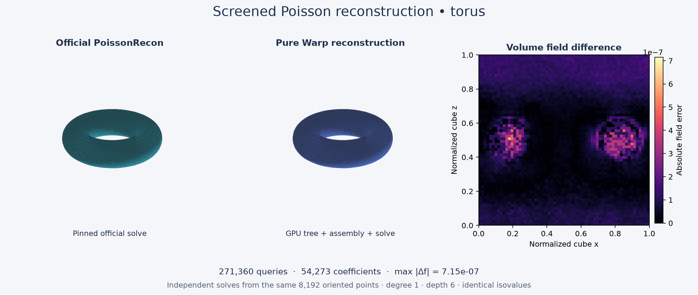

# warp-psr

Poisson Surface Reconstruction (PSR) and Screened Poisson Surface Reconstruction
(SPSR) in NVIDIA Warp. The GPU builds its own adaptive tree, density and normal
fields, assembles through `warp.fem`, solves the reference's multilevel system,
and evaluates implicit values and gradients.

The float32 degree-1 implementation now matches the pinned official output on
sphere, sparse, and torus fixtures, including PSR and both interpolation modes.
[Explicit parameter checks](docs/results/profiles.json) also vary base/solve/kernel
depths, density, scale, screening, and solver controls.
Broader profiles and performance work are tracked in
[issues](https://github.com/alecjacobson/warp-psr/issues), following the
[design](Warp%20Poisson%20Reconstruction%20Design%20for%20Matching%20Implicit%20Fields.md).

## Getting started

Requires Python 3.10+ and an NVIDIA GPU supported by Warp 1.19.

```sh
git clone https://github.com/alecjacobson/warp-psr.git
cd warp-psr
python -m venv .venv
source .venv/bin/activate
pip install -e .
```

For Linux x86-64 with a CUDA 12 driver, install NVIDIA's CUDA 12 wheel:

```sh
pip install 'https://github.com/NVIDIA/warp/releases/download/v1.19.0/warp_lang-1.19.0%2Bcu12-py3-none-manylinux_2_28_x86_64.whl'
```

```python
import warp as wp
from warp_psr import reconstruct

wp.init()
# points and normals: sequences of 3D positions and oriented normal vectors.
p = wp.array(points, dtype=wp.vec3, device="cuda")
n = wp.array(normals, dtype=wp.vec3, device="cuda")
result = reconstruct(p, n, depth=6, full_depth=3, point_weight=2.0)
values, gradients, valid = result.evaluate(p)
print(result.iso_value)  # The reconstructed surface is value == iso_value.
```

Use `point_weight=0.0` for PSR. `gradients` are in input coordinates; out-of-domain
queries produce NaN and a false validity mask. Mesh extraction is external.
Production reconstruction uses Warp arrays, kernels, FEM, and sparse algebra;
NumPy, SciPy, and the C++ reference are used only by tests and visualization.

## Flagship: independent torus reconstruction



Both implementations reconstruct the same **8,192 oriented points**, at depth 6.
Across **271,360 volume and sample queries**, maximum field error is **7.16e-7**;
the isovalue is identical. The largest cell-width-scaled gradient error uses
**4.8% of the design tolerance**. Raw cube-gradient error is **6.45e-5**, reported
separately rather than hidden by the scaling. Both panels use the same
visualization-only marching-cubes extractor.

The [validation report](docs/results/validation.json) records fixtures, source
hashes, parameters, and errors. The reference is
[PoissonRecon 262b0f5](https://github.com/mkazhdan/PoissonRecon/tree/262b0f539d404057d1f36e1adc07fc9388678899),
and the Warp pin is
[1.19.0](https://github.com/NVIDIA/warp/tree/06ce5ea6d5e29590706c7d3d48135ffdcc730912).

## Reproduce the comparison

```sh
pip install -e '.[test,visualization]'
sudo apt-get install g++ libjpeg-dev libturbojpeg0-dev libpng-dev zlib1g-dev
python tools/build_reference.py
python tools/make_fixture.py --name torus --shape torus --count 8192 --depth 6 --full-depth 3 --grid 64
python -m tools.check_reconstruction .build/fixtures/torus
python -m tools.render_comparison .build/fixtures/torus
```

`python -m tools.validate` runs the reference, operator, preprocessing, and
reconstruction gates and regenerates the report. Build products stay in ignored
`.build/`. See [reference tooling](reference/README.md) for instrumentation.

## Supported profile and known limits

The current API accepts float32 CUDA inputs, degree 1, Neumann boundaries,
confidence disabled, finite positions, and scale > 1. Base depth must be at least
1, and `depth - full_depth <= 7` reflects Warp’s eight-level geometry limit.
Depth, full/base/solve/kernel depths, density target, screening weight,
interpolation mode, and iteration settings are explicit arguments. Unsupported
profiles fail before reconstruction. The alignment matches the reference library's
`alignDir=0`; CLI comparisons explicitly request that setting.

The pinned reference has two consequential quirks preserved for compatibility:
its normal splat's parent contribution goes to the same fine level
([#12](https://github.com/alecjacobson/warp-psr/issues/12)), and `--exact` discards
all point constraints because space flags are initialized too late
([#16](https://github.com/alecjacobson/warp-psr/issues/16)). Thus
`exact_interpolation=True` reproduces that pinned behavior. It does not provide
corrected exact screening.

Remaining work includes full float64 preprocessing/solving, complete ghost/flag
and query-family coverage, base-depth-zero support, and larger performance
experiments. Float64 field evaluation is available;
[the built-in float64 FEM gradient issue](https://github.com/alecjacobson/warp-psr/issues/8)
is tracked separately. No Warp fork is needed for the current application-local
basis extension.

## Performance

On an NVIDIA L40, quadrature reuse, occupied-cell point assembly, indexed
relaxation with reusable launch commands, and per-level integration reduce the 100,000-point warm median
from **2.68 s to 0.75 s** and peak device-pool usage from **19.46 GiB to
7.30 GiB**. This follows the earlier tree optimization from 496 ms to 34 ms.

| Torus samples | Depth / full depth | Basis coefficients | Integration cells | Warp warm median | Official serial median | Peak device pool |
| ---: | ---: | ---: | ---: | ---: | ---: | ---: |
| 100,000 | 8 / 4 | 911,002 | 1,223,993 | 0.75 s | 2.52 s | 7.30 GiB |
| 1,000,000 | 8 / 4 | 963,898 | 1,265,874 | 0.84 s | 3.09 s | 7.78 GiB |
| 1,000,000 | 9 / 4 | 3,770,690 | 5,035,948 | 3.13 s | 12.30 s | 31.22 GiB |

The [current launch-reuse measurements](docs/results/launch-performance.json),
[per-level measurements](docs/results/level-performance.json),
[quadrature measurements](docs/results/fem-performance.json), and
[earlier tree measurements](docs/results/tree-performance.json) include Python
orchestration and exclude input upload and queries. Warm medians use three runs
after the first invocation; the disk kernel cache may already be populated.
Memory is the CUDA pool's process high-water mark. The
[official timings](docs/results/reference-performance.json) measure only the
unchanged library solve on one Xeon Platinum 8362 thread, matching the accuracy
fixtures; input parsing, query evaluation, and export are excluded. Parallel
reference throughput remains unmeasured.

```sh
python -m tools.benchmark --count 100000 --depth 8 --full-depth 4
python -m tools.benchmark_reference --count 100000 --depth 8 --full-depth 4
```

All larger reconstructions pass the same accuracy budgets. Maximum field error
is [1.02e-6 for 100,000 points](docs/results/torus-100k.json) and
[9.54e-7 for one million](docs/results/torus-1m.json), including every sample
position in the query set. At depth 9, the [million-point report](docs/results/torus-1m-d9.json)
records a maximum field error of 1.26e-6 and scaled gradient errors within 8.03%
of the budget. Gradient comparisons include exact knot planes.
The pinned reference intersects left-cell neighbors with right-cell polynomial
pieces at knots, which can differ from either ordinary one-sided derivative.
Reconstruction evaluation preserves this behavior and the reference's inward
boundary nudges; see [#20](https://github.com/alecjacobson/warp-psr/issues/20).
