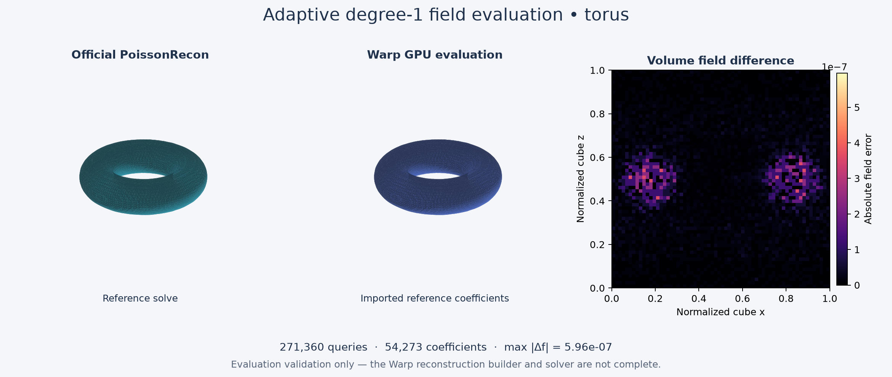

# warp-psr

A compatibility-first implementation of Poisson Surface Reconstruction (PSR) and
Screened Poisson Surface Reconstruction (SPSR) in NVIDIA Warp, following the
[design](Warp%20Poisson%20Reconstruction%20Design%20for%20Matching%20Implicit%20Fields.md).
The target is the same adaptive implicit field as pinned PoissonRecon, not only a
visually similar mesh.

**Status: under development. A complete GPU reconstruction API is not available.**
Implemented building blocks include GPU sample normalization/aggregation, Warp FEM
stiffness and point-screening assembly, and sparse per-level field evaluation.
Density estimation, adaptive tree completion and the reconstruction solver remain
in progress.
Progress and known problems are tracked in [issues](https://github.com/alecjacobson/warp-psr/issues).
Performance optimization follows the field-compatibility gates.

## Getting started

Python 3.10+ and a C++17 compiler are required for the development tools.

```sh
git clone https://github.com/alecjacobson/warp-psr.git
cd warp-psr
python -m venv .venv
source .venv/bin/activate
pip install -e '.[test,visualization]'
sudo apt-get install g++ libjpeg-dev libturbojpeg0-dev libpng-dev zlib1g-dev
python tools/build_reference.py
python tools/make_fixture.py --name sphere
python tools/check_environment.py
pytest -q
python -m tools.check_cli .build/fixtures/sphere
python -m tools.check_field .build/fixtures/sphere
```

On Linux x86-64 with a CUDA 12 driver, install NVIDIA's CUDA 12 wheel before GPU
validation. The default Warp 1.19 wheel requires a CUDA 13 driver.

```sh
pip install 'https://github.com/NVIDIA/warp/releases/download/v1.19.0/warp_lang-1.19.0%2Bcu12-py3-none-manylinux_2_28_x86_64.whl'
```

Reference sources and generated fixtures live under ignored `.build/` and never
enter the production package. Allow several GB of disk space for dependencies and
build products. See [reference tooling](reference/README.md) for export details.

## Compatibility target

Initial scope: degree 1, Neumann boundaries, oriented points, zero or positive
screening weight, exact and approximate point interpolation. The pinned sources are
[PoissonRecon 262b0f5](https://github.com/mkazhdan/PoissonRecon/tree/262b0f539d404057d1f36e1adc07fc9388678899)
and [Warp 1.19.0](https://github.com/NVIDIA/warp/tree/06ce5ea6d5e29590706c7d3d48135ffdcc730912).
No Warp fork is currently required by the implemented float32 experiments.

| Stage | Tracking |
|---|---|
| Reference baseline and instrumentation | [#1](https://github.com/alecjacobson/warp-psr/issues/1) |
| Uniform FEM equivalence | [#2](https://github.com/alecjacobson/warp-psr/issues/2) |
| Adaptive spaces and level coupling | [#3](https://github.com/alecjacobson/warp-psr/issues/3) |
| GPU hierarchy, density, normal field | [#4](https://github.com/alecjacobson/warp-psr/issues/4) |
| Complete PSR/SPSR solves | [#5](https://github.com/alecjacobson/warp-psr/issues/5) |
| Flagship reconstruction and optimization | [#6](https://github.com/alecjacobson/warp-psr/issues/6) |

## Current visual result: adaptive field evaluation



This is **evaluation of reference-generated coefficients on the GPU**, not a
complete Warp reconstruction. Both meshes use the same visualization-only
marching-cubes extractor. For 8,192 torus samples at depth 6, the GPU evaluator
matches 271,360 volume/sample queries with maximum field error **5.96e-7** and
maximum model-gradient error **7.63e-6**. Instrumentation does not change the
reference field. The independent GPU solve remains open in #5.

Reproduce the figure:

```sh
python tools/make_fixture.py --name torus --shape torus --count 8192 --depth 6 --full-depth 3 --grid 64
python -m tools.check_field .build/fixtures/torus
python -m tools.render_comparison .build/fixtures/torus
```

Run all current gates and regenerate the figure/report with
`python -m tools.validate` (requires CUDA).

The [validation report](docs/results/validation.json) records the exact scope and
measured errors. All production modules use Warp; NumPy, SciPy, C++ oracle code
and mesh visualization are confined to development tools/tests. The uniform-grid
helper is bounded and explicitly for verification, not a dense reconstruction
fallback. No end-to-end performance or reconstruction-accuracy claim is made.

Known limits: the input-processing prototype supports float32 CUDA arrays,
finite positions, confidence disabled, scale > 1, and explicit library alignment
`alignDir=0`. Nonfinite/zero normals are rejected from aggregation. Out-of-domain
field queries return NaN with a validity mask. Exact knot queries use the right
cell, except at the upper boundary. Float64 field evaluation works, but
[float64 FEM gradient assembly](https://github.com/alecjacobson/warp-psr/issues/8)
is currently blocked by a Warp type mismatch. The C++ CLI defaults to
`alignDir=2`; our comparisons explicitly request `0`.
