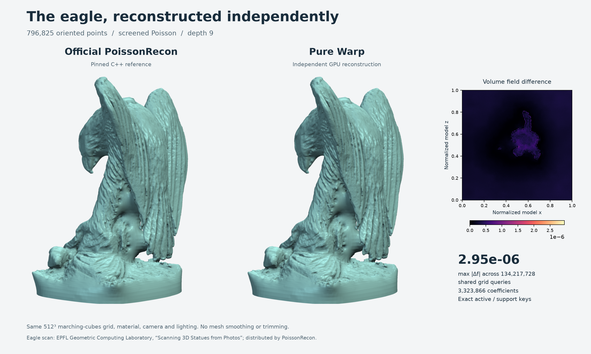

# warp-psr

Poisson Surface Reconstruction (PSR) and Screened Poisson Surface Reconstruction
(SPSR) in NVIDIA Warp. The GPU builds its own adaptive tree, density and normal
fields, assembles with `warp.fem` and verified spline stencils, solves the reference's multilevel system,
and evaluates implicit values and gradients.

The float32 and float64 degree-1 implementations match the pinned official output on
sphere, sparse, and torus fixtures, including PSR and both interpolation modes.
Public-cloud checks also cover horse, Stanford bunny, eagle, and torso scans in
both precisions. The [71-case dataset catalog](docs/datasets.md) adds mesh-derived
drill, armadillo, dragon and Happy Buddha inputs, plus controlled input defects.
[Explicit parameter checks](docs/results/profiles.json) also vary base/solve/kernel
depths, density, scale, screening, and solver controls.
Broader profiles and performance work are tracked in
[issues](https://github.com/alecjacobson/warp-psr/issues), following the
[design](Warp%20Poisson%20Reconstruction%20Design%20for%20Matching%20Implicit%20Fields.md).

## Getting started

Requires Python 3.10+ and an NVIDIA GPU supported by Warp 1.19.

```sh
git clone https://github.com/alecjacobson/warp-psr.git
cd warp-psr
python -m venv .venv
source .venv/bin/activate
pip install -e .
```

For Linux x86-64 with a CUDA 12 driver, install NVIDIA's CUDA 12 wheel:

```sh
pip install 'https://github.com/NVIDIA/warp/releases/download/v1.19.0/warp_lang-1.19.0%2Bcu12-py3-none-manylinux_2_28_x86_64.whl'
```

```python
import warp as wp
from warp_psr import reconstruct

wp.init()
# points and normals: sequences of 3D positions and oriented normal vectors.
p = wp.array(points, dtype=wp.vec3, device="cuda")
n = wp.array(normals, dtype=wp.vec3, device="cuda")
result = reconstruct(p, n, depth=6, full_depth=3, point_weight=2.0)
values, gradients, valid = result.evaluate(p)
print(result.iso_value)  # The reconstructed surface is value == iso_value.
```

Use `point_weight=0.0` for PSR. `gradients` are in input coordinates; out-of-domain
queries produce NaN and a false validity mask. Optional [GPU mesh extraction](docs/meshing.md)
provides Warp dense and sparse marching cubes without adding work to reconstruction.
Opt-in [reconstruction differentiation](docs/differentiability.md) propagates
field and mesh vertex losses to input points and normals through the finite
solver, with discrete assignments fixed.
Use `dtype=wp.vec3d` for both input arrays to run the entire pipeline in float64,
including normalization, density, assembly, solving, and evaluation.
Production reconstruction uses Warp arrays, kernels, FEM, and sparse algebra;
NumPy, SciPy, and the C++ reference are used only by tests and visualization.
Zero or invalid normals are omitted. If all accepted aggregate normals cancel,
the field, its gradient, and the isovalue are zero,
[matching the pinned reference](docs/results/cancelled-normals.json).

## Flagship: the eagle



The **796,825-point eagle scan** reconstructs at depth 9 with **3,323,866 basis
coefficients**. Both independent solves have exactly the same active and support
keys. Across **812,815 diagnostic queries**, including every input point and
refinement interfaces, maximum field error is **5.51e-7**; scaled gradient error
uses **4.63% of the fixed design tolerance**. The isovalues match exactly.

The figure records the earlier reconstruction revision in its provenance and
compares **134,217,728 shared volume-grid samples**, with
maximum field error **2.95e-6**. Both panels use the same marching-cubes extraction,
material, camera, and lighting, with no mesh smoothing or trimming. See the
[field report](docs/results/eagle.json) and [render provenance](docs/results/eagle-reconstruction.json).
The scan is from the **EPFL Geometric Computing Laboratory**,
[Scanning 3D Statues from Photos](https://lgg.epfl.ch/statues.php), distributed
through PoissonRecon's example datasets.
The [gallery](docs/gallery.md) also compares the full horse, bunny, and torso inputs.

## Reproduce the comparison

```sh
pip install -e '.[test,rendering]'
sudo apt-get install g++ libjpeg-dev libturbojpeg0-dev libpng-dev zlib1g-dev
python tools/build_reference.py
python tools/make_fixture.py --name eagle-full-d9-spsr --dataset eagle --depth 9 --full-depth 4 --grid 24
python -m tools.check_reconstruction .build/fixtures/eagle-full-d9-spsr
python -m tools.export_grid .build/fixtures/eagle-full-d9-spsr --resolution 512
python -m tools.render_flagship .build/fixtures/eagle-full-d9-spsr --resolution 512
```

The pinned reference is
[PoissonRecon 262b0f5](https://github.com/mkazhdan/PoissonRecon/tree/262b0f539d404057d1f36e1adc07fc9388678899),
and Warp is [1.19.0](https://github.com/NVIDIA/warp/tree/dca5011a3fd9857756ccd9824c637ca6f8b436d6).
Downloads and build products stay in ignored `.build/`. The large dense grid is
used only for visualization; the reconstruction itself is adaptive.

`python -m tools.validate` runs the synthetic reference, operator, preprocessing,
and reconstruction gates. `python -m tools.check_datasets --suite smoke` runs
[16 public-cloud PSR/SPSR checks](docs/results/public-smoke.json) in float32 and
float64. The [15 scaling cases](docs/results/public-scaling-accuracy.json) also pass,
including the full 3.49-million-point torso, independent sample-count and density
sweeps, and depth-9 eagle and million-point torso reconstructions. Across these
cases the maximum field error is **4.71e-6**, and scaled gradient errors stay below
**15.9% of the design budget**. The [dataset guide](docs/datasets.md) describes
matched benchmarks, source checksums, and reproducible subsets.

The [40 additional cases](docs/results/expanded-datasets.json) cover four more
geometries and deterministic position noise, normal noise, missing regions and
outliers, with both PSR/SPSR and both precisions. All pass the same fixed C++
compatibility budgets. Their [differentiable-path checks](docs/results/expanded-datasets-adjoints.json)
also pass exact tracked/default forward comparisons and input-gradient invariants.
Run them with `--suite extended` and `--suite stress`; `--suite all` selects all 71.

## Supported profile and known limits

The current API accepts matching float32 or float64 CUDA inputs, degree 1, Neumann boundaries,
confidence disabled, finite positions, and scale > 1. Reconstruction depth is
1 through 15; base and full depth may be zero. The constraint
`depth - full_depth <= 7` reflects Warp’s eight-level geometry limit.
Depth, full/base/solve/kernel depths, density target, screening weight,
interpolation mode, and iteration settings are explicit arguments. Unsupported
profiles fail before reconstruction. The alignment matches the reference library's
`alignDir=0`; CLI comparisons explicitly request that setting.

The pinned reference has three consequential quirks preserved for compatibility:
its normal splat's parent contribution goes to the same fine level
([#12](https://github.com/alecjacobson/warp-psr/issues/12)), and `--exact` discards
all point constraints because space flags are initialized too late
([#16](https://github.com/alecjacobson/warp-psr/issues/16)). Thus
`exact_interpolation=True` reproduces that pinned behavior. It does not provide
corrected exact screening. It also prolongs quadratic normal coefficients with
degree-1 test-space weights ([#35](https://github.com/alecjacobson/warp-psr/issues/35));
matching that transfer is essential for heavily clustered samples.

The end-to-end float64 diagnostic fixtures cover sphere PSR/SPSR/exact, a sparse
tree, and the torus. Maximum field error is **5.78e-15** across those fixtures.
Preprocessing and operator checks use `atol=1e-10, rtol=1e-9`; field, isovalue,
and cell-width-scaled gradient checks use `atol=1e-8, rtol=1e-6`.
The [validation report](docs/results/validation.json) records both precisions.

The [geometry checks](docs/results/geometry-profiles.json) also cover plane patches,
nearby sheets, dense clusters, disconnected components, and translated/scaled
inputs in both precisions. Named queries cover every integration depth, both
sides of refinement interfaces, cube boundaries, and regions far from samples.
Reports include raw and isovalue-centered fields and per-family gradient errors.

The [repeatability report](docs/results/repeatability.json) compares three fresh
GPU solves with three serial and three default-parallel official solves on a
float32 sphere and a float64 cluster. It records canonical active-basis hashes,
raw/centered fields, gradients, isovalues, and the actual thread settings.
Parallel variation is measured separately from the fixed serial compatibility
budgets. Run `python -m tools.check_repeatability` after generating the fixtures;
it is also included in `tools.validate`.

The [threshold checks](docs/results/thresholds.json) cover quantized positions on
both sides of dyadic cell boundaries, coincident and opposing normals, zero normals,
and adjacent density settings that change the pinned oracle's integer splat depth.
Both precisions pass exact aggregate and tree checks and three independent field
acceptance runs per case. Run `python -m tools.check_thresholds` to reproduce the
oracle search and all eight cases without changing the fixed numerical budgets.

The [complete retained-tree checks](docs/results/tree-metadata.json) cover ghost and
flag metadata, parent/child identities, and padded roots. Optional
[solver traces](docs/solver-traces.md) export every relaxation visit and CG stopping
decision; independent serial replay checks each update bit for bit.
Three Warp float64
issues have tested upstream proposals: [built-in B-spline gradients](https://github.com/NVIDIA/warp/pull/2219),
[sparse-grid particle lookup](https://github.com/NVIDIA/warp/pull/2221), and
[regular-grid particle lookup](https://github.com/NVIDIA/warp/pull/2233).
The application uses public basis and explicit-coordinate quadrature interfaces
and needs no Warp fork.

## Performance

Measured on an NVIDIA L40 against pinned C++ PSR/SPSR on a Xeon Platinum 8362
with a **four-core CPU quota and four OpenMP threads**. The C++ compatibility
build uses `-O2` without fast-math. All rows use float32, full/base depth 4,
density target 1.5 and eight iterations. Ratios below are speedups over C++.

| Input | Points | Depth 8 PSR | Depth 8 SPSR | Depth 9 PSR | Depth 9 SPSR |
| --- | ---: | ---: | ---: | ---: | ---: |
| Horse | 100,000 | 8.1× | 8.4× | 16.1× | 13.6× |
| Bunny | 362,271 | 16.4× | 18.5× | 25.7× | 21.6× |
| Eagle | 796,825 | 13.9× | 13.9× | 25.1× | 27.0× |
| Torso | 3,488,432 | 14.7× | 15.3× | 24.9× | 21.2× |
| Drill | 1,961 | 2.3× | 2.6× | 2.8× | 2.8× |
| Armadillo (subset) | 100,000 | 15.6× | 14.9× | 17.0× | 21.3× |
| Dragon (subset) | 100,000 | 14.1× | 17.8× | 23.5× | 17.9× |
| Happy Buddha (subset) | 100,000 | 13.9× | 13.2× | 18.2× | 18.2× |

Every depth-9 row was freshly validated and timed on **November 6, 2026**.
Depth 8 retains the previously recorded measurements. Inputs are byte-identical
between depths; drill, armadillo, dragon and Happy Buddha are mesh-derived tests.
All 16 depth-9 profiles pass unchanged GPU/reference and four-thread/reference
field, gradient, isovalue and exact-tree checks.

The fresh eagle SPSR result is **0.2097 s GPU / 5.6616 s CPU = 27.0×**.
Two A–B–B–A rounds against the previously published GPU revision found
**no regression**: 210.9 ms before versus 209.7 ms now, within timing noise.
The increase from the earlier 22.7× ratio mainly reflects a slower fresh CPU
measurement. See [all recheck samples](docs/results/eagle-depth9-recheck.json).

These are warm reconstruction timings. GPU timing includes Python orchestration
and excludes upload, queries, differentiation and meshing; C++ timing excludes
parsing, queries, export and process startup. Depth-9 rows use five measured runs
after the first invocation, except eagle SPSR's preplanned 28-sample pooled GPU
median and seven-run CPU median. Every table measurement passed the isolation check.

The [performance guide](docs/performance.md#eight-datasets-at-depths-8-and-9)
contains absolute GPU/CPU times, memory, methodology, reproduction commands and
historical sample-count/density sweeps. The [full depth-9 report](docs/results/depth9-datasets.json)
and [unrounded table](docs/results/dataset-speedups.json) preserve all measurements
and provenance. The existing `--suite all` catalog remains 71 named cases.
