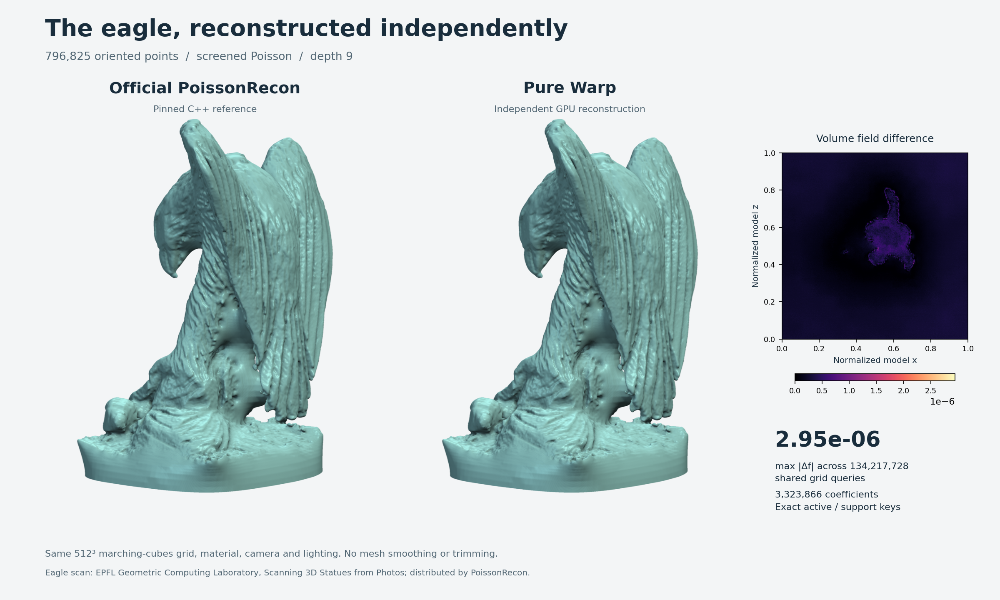
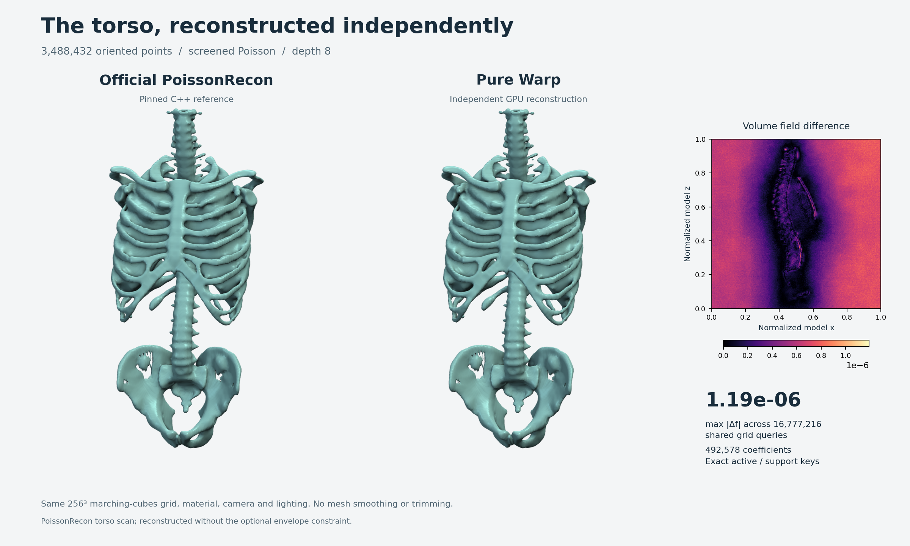
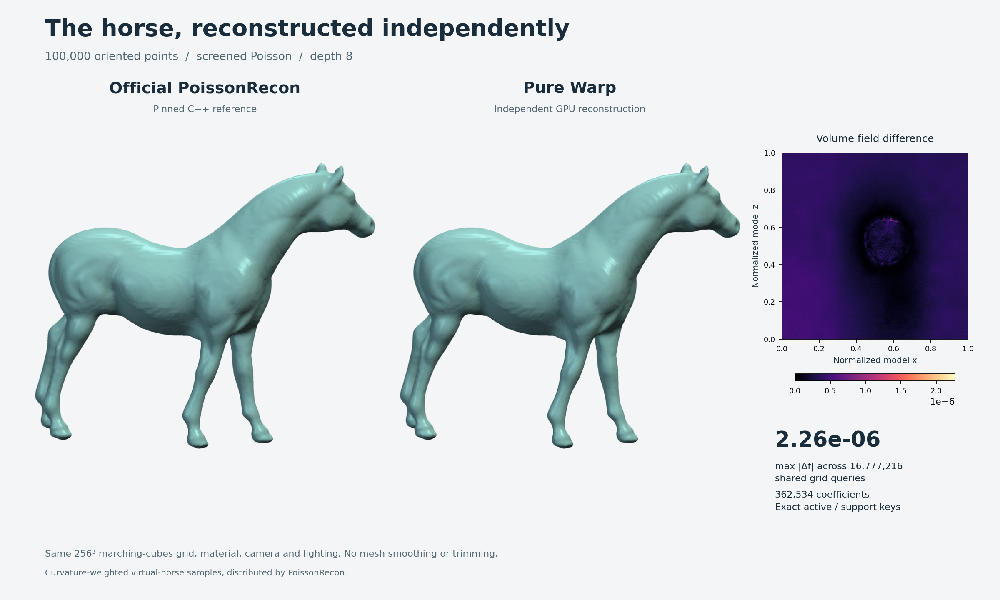
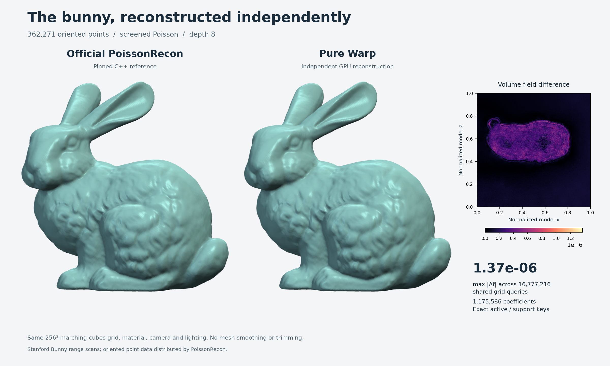

# Public cloud reconstruction gallery

Each comparison starts from the same original oriented points and independently
reconstructs the pinned official and pure-Warp implicit fields. Both panels use
the same marching-cubes extractor, camera, material, and lighting. Mesh vertices
are not smoothed, decimated, or trimmed. The adjacent slice shows volume-field
error; the stated maximum covers the entire visualization grid.

The eagle is the flagship for its detailed feather geometry. The torso adds
thin ribs, large gaps, and 3.49 million input points; the horse has deliberately
nonuniform curvature sampling; the bunny combines overlapping range scans.
All four pass the same fixed numerical budgets and exact active/support-key checks.
See the [dataset guide](datasets.md) for source attribution, input provenance,
and reproducible experiment commands.

## Eagle

796,825 points at depth 9.

EPFL Geometric Computing Laboratory, [Scanning 3D Statues from Photos](https://lgg.epfl.ch/statues.php).
[Grid and rendering provenance](results/eagle-reconstruction.json).

## Torso

3,488,432 points at depth 8.

PoissonRecon's oriented torso dataset, reconstructed without its optional envelope
constraint. [Grid and rendering provenance](results/torso-reconstruction.json).

## Horse

100,000 points at depth 8.

Curvature-weighted virtual-horse samples distributed by PoissonRecon.
[Grid and rendering provenance](results/horse-reconstruction.json).

## Stanford bunny

362,271 points at depth 8.

Stanford Bunny range scans with oriented normals supplied by PoissonRecon.
[Grid and rendering provenance](results/bunny-reconstruction.json).

## Reproduce the camera settings

After exporting each grid with `tools.export_grid`, pass its resolution and the
following `--camera` and `--up` values to `tools.render_flagship`. Shared framing
is automatic. Each image sidecar records the exact field hashes and framing.

| Input | Fixture | Grid | Camera | Up |
| --- | --- | ---: | --- | --- |
| Horse | `horse-full-d8-spsr` | 256 | `2 0.8 0.35` | `0 0 1` |
| Bunny | `bunny-full-d8-spsr` | 256 | `0.6 0.2 2` | `0 1 0` |
| Torso | `torso-full-d8-spsr` | 256 | `2 0.4 0.3` | `0 0 1` |
| Eagle | `eagle-full-d9-spsr` | 512 | `2 -0.5 -2` | `0 -1 0` |
