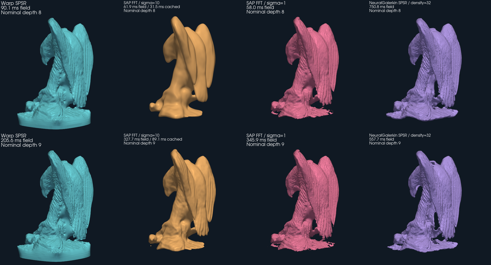
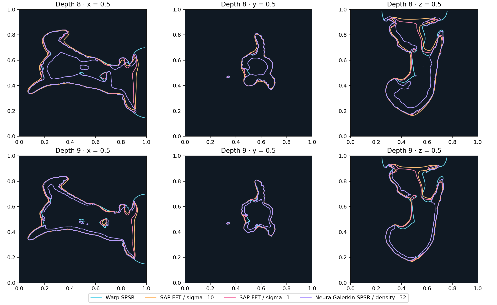

# Other GPU Poisson reconstruction formulations

This experiment compares Warp SPSR with the official
[Shape As Points / DPSR](https://github.com/autonomousvision/shape_as_points)
FFT solver and the **non-learned SPSR path** of
[NeuralGalerkin](https://github.com/huangjh-pub/neural-galerkin/tree/pth).
It measures the performance range of different formulations, not speedups for
equivalent answers. It does not measure NeuralGalerkin's trained network.
The bibliography and follow-up work are tracked in
[#92](https://github.com/alecjacobson/warp-psr/issues/92).

## Measured results, November 10, 2026

Warm field reconstruction times in **milliseconds**, on one NVIDIA L40 with a
four-core CPU quota. The cached SAP column removes repeated constant-frequency
construction/transfer from its forward call. This matters: on eagle, Warp takes
90.1/205.6 ms at depths 8/9, versus **31.5/89.1 ms for cached FFT**. Warp is
2.9×/2.3× slower there; the depth-8 gap reaches 8.8× on dragon. At depth 9,
Warp/cached-FFT time ratios range from 0.88 to 3.62 across these eight inputs.
These are different mathematical solutions, but the comparison identifies
remaining performance headroom, tracked in [#94](https://github.com/alecjacobson/warp-psr/issues/94).

### Depth 8

| Dataset | Points | Warp SPSR | SAP FFT | SAP cached | NG default | NG lower density |
| --- | ---: | ---: | ---: | ---: | ---: | ---: |
| Eagle | 796,825 | 90.1 | 61.9 | 31.5 | 750.8 | 808.9 |
| Horse | 100,000 | 74.1 | 40.6 | 10.9 | 106.1 | 198.7 |
| Bunny | 362,271 | 107.1 | 46.2 | 17.3 | fails | 662.2 |
| Armadillo | 100,000 | 90.4 | 42.6 | 10.6 | fails | 335.9 |
| Buddha | 100,000 | 84.1 | 44.1 | 10.7 | fails | 232.4 |
| Dragon | 100,000 | 96.2 | 43.3 | 10.9 | fails | 306.1 |
| Drill | 1,961 | 56.3 | 39.7 | 9.1 | fails | 56.8* |
| Torso | 1,000,000 | 78.7 | 63.8 | 37.8 | 891.8 | 874.6 |

### Depth 9

| Dataset | Points | Warp SPSR | SAP FFT | SAP cached | NG default | NG lower density |
| --- | ---: | ---: | ---: | ---: | ---: | ---: |
| Eagle | 796,825 | 205.6 | 327.7 | 89.1 | 557.7 | 2566.4† |
| Horse | 100,000 | 95.3 | 318.1 | 66.9 | 89.1 | 327.3 |
| Bunny | 362,271 | 264.2 | 311.6 | 72.9 | fails | OOM |
| Armadillo | 100,000 | 116.0 | 293.5 | 67.2 | fails | 743.9 |
| Buddha | 100,000 | 126.9 | 301.3 | 67.1 | fails | 494.8 |
| Dragon | 100,000 | 129.2 | 297.4 | 67.3 | fails | 590.5 |
| Drill | 1,961 | 57.6 | 301.3 | 65.6 | fails | 63.3* |
| Torso | 1,000,000 | 152.1 | 326.7 | 94.7 | 1028.9 | 1855.5† |

`NG default` uses the public wrapper's density threshold 32. It rejects empty
finest levels on five datasets at each depth; `fails` means no timing is claimed.
`NG lower density` uses threshold 1, except **\* drill uses 0.01**. These are
separate configurations with different hierarchies and output fields.
**†** Eagle and torso at depth 9 use PyTorch's `expandable_segments:True`
allocator after the default allocator ran out of memory. Bunny at depth 9
still ran out of memory with either allocator. All attempts are retained in
[the full report](results/gpu-baselines.json); the [CSV](results/gpu-baselines.csv)
preserves unrounded timings. The baseline limitations are tracked in
[#93](https://github.com/alecjacobson/warp-psr/issues/93).

Nominal depth alone is particularly misleading for NG: eagle at depth 9 has
only 2,202 finest-level unknowns with the default density threshold, versus
942,413 at threshold 1. The latter takes 2.57 s and peaks at 45.7 GiB of live
PyTorch allocations. The two configurations need separate timing and output
comparisons.

## Output comparison



Eagle, 796,825 oriented points; matched cameras and lighting. SAP's original
and cached timings refer to the same formulation. Its default `sigma=10`
strongly smooths feather detail at depth 8; `sigma=1` restores much of it.
The pedestal differs materially between methods. No mesh smoothing or trimming
was applied; smooth shading only interpolates normals for rendering. NG uses
its default density 32 and its public wrapper's 2× extraction upsampling.
Data: EPFL Geometric Computing Laboratory, “Scanning 3D Statues from Photos,”
distributed by the PoissonRecon project.



These zero contours use the same 192×192 query planes, independently of mesh
extraction. NG has additional interior contours in this example. Raw field
amplitudes have different scales, so these plots compare surface location.
The experiment does not isolate periodicity from all other formulation changes;
the within-SAP sigma sweep does isolate its smoothing parameter.

Area-weighted surface sampling quantifies the disagreement with the Warp mesh:

| Surface | RMS distance at depth 8 (% cube side) | Depth 9 (% cube side) |
| --- | ---: | ---: |
| Warp independent resampling (sampling floor) | 0.162 | 0.164 |
| SAP sigma 10 | 2.737 | 2.283 |
| SAP sigma 1 | 2.034 | 1.882 |
| NG default | 1.565 | 1.500 |

These are symmetric distances between 200,000 sampled surface points per mesh,
including the base and interior surfaces. They measure disagreement with Warp;
there is no ground-truth accuracy ranking here. See the
[metric definitions and full values](results/gpu-baselines-eagle.metrics.json).

Eagle native points-to-mesh medians are 0.102/0.301 s for Warp,
0.310/2.109 s for published SAP, and 1.137/0.865 s for NG default, at depths 8/9.
Extraction details and timing boundaries follow below.

## What is comparable

Each method receives the same hashed float32 oriented cloud. SAP and
NeuralGalerkin receive positions normalized into the same axis-aligned cube
with scale 1.1; Warp performs its pinned normalization during reconstruction.
Depth 8/9 means a nominal finest cell width of 1/256 or 1/512 of that cube.
It does **not** mean equal effective resolution, basis counts, smoothing,
boundary conditions, or screening strength.

| Method | Discretization and solve | Boundary / surface definition |
| --- | --- | --- |
| Warp SPSR | Adaptive degree-one basis; reference cascadic multigrid / ordered Gauss–Seidel; full/base depth 4, eight iterations, point weight 2 | Pinned official Neumann profile; weighted sample isovalue |
| SAP DPSR | Dense periodic FFT Poisson solve; upstream Gaussian `sigma=10`, with `sigma=1` sensitivity runs on eagle | Periodic grid, zero Fourier DC mode; sample-mean shift and upstream scale normalization; no screening term |
| NeuralGalerkin SPSR | Adaptive sparse hierarchy with four levels, quadratic Bezier tensor basis, density threshold 32, screening alpha 4; coarse-to-fine Jacobi-PCG at relative tolerance 1e-5 | Truncated-domain Dirichlet formulation; weighted sample isovalue; different screening scale from Warp |

NeuralGalerkin's `depth=4` counts hierarchy levels, not an octree depth of four.
Its finest voxel size here is 1/256 or 1/512. The public wrapper's alpha default
is 4; its horse visualization example uses 32. We do not equate either to
PoissonRecon's point weight 2. See the pinned
[DPSR forward](https://github.com/autonomousvision/shape_as_points/blob/a094733f127b9be888aa8728d41cca3dd9b36394/src/dpsr.py),
[NG wrapper](https://github.com/huangjh-pub/neural-galerkin/blob/5ec184004edbbf7492e49167d5063ac16712f629/torch_spsr/__init__.py),
and [NG multigrid implementation](https://github.com/huangjh-pub/neural-galerkin/blob/5ec184004edbbf7492e49167d5063ac16712f629/torch_spsr/core/reconstructor.py).

Timings synchronize at the boundaries and include Python orchestration,
allocation, hierarchy construction, matrix assembly, solving and the surface
isovalue. They exclude input file parsing/upload, external input normalization,
module construction, mesh extraction and diagnostic slices. Setup and first
invocation are recorded separately. SAP's repeated CPU frequency construction
and transfer inside `forward` remain included. Five warm runs follow the first
invocation (seven for eagle's cached FFT); none reuse a solved field or an
input-dependent matrix. These are warm comparisons; setup and first invocation
are not clean-cache compilation measurements.

An additional sensitivity run on every dataset caches SAP's input-independent
frequency and Laplacian tensors during setup. It preserves the FFT solve, smoothing and
periodic boundary conditions, and tests whether the published implementation's
CPU work obscures the practical FFT performance range. This is labeled as a
modified implementation. Each cached run first checks bitwise equality on a
deterministic 8,192-point, 64³ case. A separate validation checks **every field
value** for all 796,825
eagle points at 256³ and 512³: both are bit-identical, with maximum difference
zero. Timings use the usual non-deterministic CUDA splat.

Eagle also includes native extraction: Warp GPU sparse MC, NeuralGalerkin GPU
multiscale dual MC (`n_upsample=2`), and SAP field download plus CPU scikit-image
MC. Their extraction grids/topologies differ, so points-to-mesh timing is a
separate comparison, not an interchangeable extractor benchmark.
SAP's dense field could also feed a GPU extractor; its CPU extraction cost here
does not establish a lower bound on FFT points-to-mesh performance.
The NeuralGalerkin adapter caches the sample-derived isovalue computed during
field reconstruction; its original convenience wrapper recomputes that same
mean during multiscale mesh evaluation. Thus this is the separated API's
points-to-mesh timing, not a timing of the original convenience wrapper.

## Implementation observations

NeuralGalerkin caches CSR representations and inverse diagonals. Warp already
uses CSR matrices; the inverse-diagonal experiment precomputes the identical
reciprocal once per fine-level matrix and reuses it in the existing ordered
relaxation graph. Residual accumulation, sweep order and iteration count stay
unchanged. The experiment compares complete keys, field coefficients and
isovalue bit-for-bit on every reconstruction and uses interleaved ABBA runs.

Inverse-diagonal reuse was 2.5–6.1% slower on all six eagle/horse/bunny cases at depths
8 and 9, so it was rejected. A second experiment captured the unchanged coarse
relaxation sweeps in CUDA graphs: five cases improved by only 1.0–2.5%, while
eagle depth 9 regressed by 4.2%. It was also rejected. Both experiments produced
bit-identical keys, coefficients and isovalues on every tested reconstruction;
neither establishes a performance improvement safe to enable by default.
Production solver code and accuracy gates remain unchanged. All 12 experiments
use seven ABBA blocks (14 warm samples per method), with four preliminary
invocations. Full samples and exact-equality results are in the report; the
[experimental scripts](results/gpu-baseline-scripts/) reproduce the coarse-graph
variant. The inverse-diagonal generator is `tools.compare_relaxation_diagonal`.

A wholesale switch to NeuralGalerkin's PCG would change our finite reference
iterate. It also would not accelerate the normally skipped eight-unknown root
CG solve on default eagle/horse, as established by the
[root solver experiments](solver-experiments.md). NeuralGalerkin's public PCG
loop returns dot products and residual norms to host scalars each iteration;
it is not an example of eliminating all iteration-level host synchronization.
Its coarse-to-fine solver explicitly does not implement a full V-cycle.

## Reproduction

Use separate environments for Warp and the optional PyTorch baselines. No
runtime dependencies are added to `warp_psr`.

- SAP revision: `a094733f127b9be888aa8728d41cca3dd9b36394`.
- NeuralGalerkin `pth` revision: `5ec184004edbbf7492e49167d5063ac16712f629`.
- PyTorch 2.5.1+cu124, torch_scatter 2.1.2+pt25cu124, Python 3.10, GCC 11.4;
  compile the CUDA extensions for the measured GPU architecture.
- NumPy 1.26.4 in the external environment and 2.2.6 in the Warp environment.
  Normalization uses explicit float32 multiplication. Six initial runs with a
  one-ULP scalar-promotion difference were repeated based on mismatched domain
  metadata; the report retains those superseded measurements.
- The CUDA 12 build needs the renamed cuSPARSE enum
  `CUSPARSE_SPMV_ALG_DEFAULT` in place of `CUSPARSE_MV_ALG_DEFAULT`; this is an
  API compatibility edit, not a solver change. CUDA library headers and library
  paths must be visible to NVCC/linker.

The [support scripts and environment record](results/gpu-baseline-scripts/README.md)
give build commands and the full-field cache validation. Use the existing
[dataset catalog](datasets.md) to generate float32 fixtures at full/base depth 4,
point weight 2 and seed 2026. The point counts in the tables identify the three
100k mesh-derived subsets and the 1m torso subset.

The SAP adapter loads the original DPSR class and its six helper functions
without importing unrelated rendering/training dependencies. The NeuralGalerkin
adapter executes its original public wrapper up to mesh extraction, then
returns the reconstructor to time the field and mesh separately. Its weighted
isovalue calculation is included in field timing. Source revisions, hashes,
upstream diff, hardware, cgroup limits, all samples and isolation observations
are recorded with results.

```sh
python -m tools.benchmark_gpu_baseline --method sap \
  --upstream /path/to/shape_as_points --fixture /path/to/eagle-fixture \
  --depth 8 --repeats 5 --mesh --output .build/eagle-d8-sap.json
python -m tools.benchmark_gpu_baseline --method ng \
  --upstream /path/to/neural-galerkin --fixture /path/to/eagle-fixture \
  --depth 8 --repeats 5 --mesh --output .build/eagle-d8-ng.json
python -m tools.benchmark_gpu_baseline --method warp \
  --fixture /path/to/eagle-fixture --depth 8 --repeats 5 --mesh \
  --output .build/eagle-d8-warp.json
python -m tools.benchmark_cached_fft --upstream /path/to/shape_as_points \
  --fixture /path/to/eagle-fixture --depth 8 --repeats 7 \
  --output .build/eagle-d8-sap-cached.json
python -m tools.compare_relaxation_diagonal --fixture /path/to/eagle-fixture \
  --depth 8 --blocks 7 --output .build/diagonal-eagle-d8.json
```

For the NG lower-density profile, add `--min-density 1` (`0.01` for drill).
For the two successful large depth-9 retries, set
`PYTORCH_CUDA_ALLOC_CONF=expandable_segments:True` before starting Python.
Warp production files were unchanged throughout the experiments; 46 benchmark
input/provenance/environment tests passed, and all new scripts compile.

Run in an idle environment, with four CPU threads and a single GPU process.
The scripts reject a visible foreign GPU process. The dataset-suite scheduler
also records one-second CPU/GPU process sampling; this cannot prove the absence
of work shorter than the sampling interval.
